 

 

## Featured projects

 

## What I care about

- **Removing manual work.** The best tool is the one that gives someone their afternoon back.
- **Software that's tested.** Aurora has 197 automated tests, and a desktop test that crashes it on purpose.
- **Getting the details right.** Clean data and careful code save more time than they cost.

## Activity

<picture>
  <source media="(prefers-color-scheme: dark)" srcset="https://raw.githubusercontent.com/Anish25012/Anish25012/output/snake-dark.svg">
  <source media="(prefers-color-scheme: light)" srcset="https://raw.githubusercontent.com/Anish25012/Anish25012/output/snake.svg">
  
</picture>
